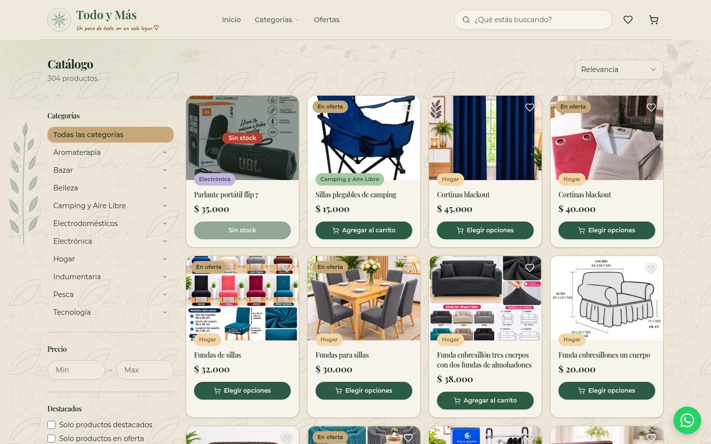
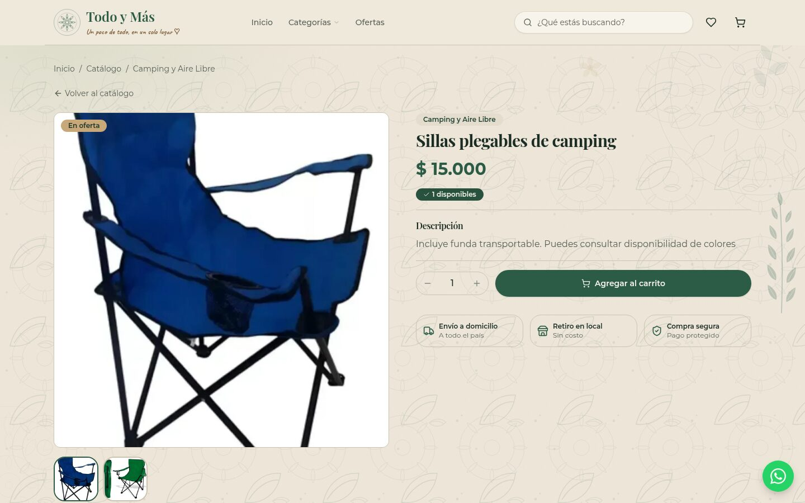
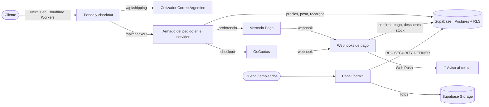

<div align="center">

# 🌿 Todo y Más

**E-commerce completo para un comercio real de Mendoza, Argentina.**
Tienda online, cobros con Mercado Pago y GoCuotas, envíos por Correo Argentino y un panel de gestión con ventas de mostrador, empleados y estadísticas.

[](https://todoymas307.com.ar)


</div>

---

## ✨ Qué es

**Todo y Más** es la tienda online de un comercio multirrubro (aromaterapia, bazar, belleza, camping, electrónica, hogar y más) con **más de 300 productos**. No es un template: está en producción, con clientes reales, pagos reales y una dueña que la administra desde el celular.

El proyecto cubre todo el circuito de venta:

> catálogo → carrito → envío → pago → aviso al celular → stock → estadísticas

## 📸 Capturas

<table>
  <tr>
    <td width="50%"></td>
    <td width="50%"></td>
  </tr>
  <tr>
    <td align="center"><sub><b>Catálogo</b> con categorías, subcategorías, precio y ofertas</sub></td>
    <td align="center"><sub><b>Producto</b> con galería, variantes y stock</sub></td>
  </tr>
</table>

<p align="center">
  <br/>
  <sub><b>Mobile first</b>: la mayoría de las compras entran desde el celular</sub>
</p>

## 🛍️ Funcionalidades

### Tienda

- **Catálogo** con categorías, subcategorías y categorías extra por producto, búsqueda, filtro por precio, destacados y ofertas.
- **Variantes** (color, aroma, modelo…) con su propia foto y stock.
- **Carrito persistente** y **favoritos**.
- **Comentarios y valoraciones** con moderación desde el panel.
- **SEO**: sitemap dinámico, metadatos y PWA instalable.

### Checkout y pagos

- **Mercado Pago** (tarjetas y cuotas), conectado por **OAuth**: la dueña vincula su propia cuenta con un clic, sin copiar claves.
- **GoCuotas**: cuotas con tarjeta de débito.
- **Transferencia**: muestra el alias y el monto para copiar, y el cliente sube el comprobante desde la misma pantalla.
- **Efectivo** al retirar en el local.
- **Recargos por medio de pago** configurables desde el panel (tarjeta, GoCuotas, etc.).
- **Precios calculados en el servidor**: precios, envío, recargo y total se recalculan desde la base. El navegador solo manda qué productos y cuántos, así que nadie puede pagar menos editando el pedido.
- **Webhooks idempotentes**: el stock se descuenta recién cuando el pago se confirma, y si el monto pagado no coincide con el total, el pedido no se confirma.

### Envíos por Correo Argentino

Cotización automática por código postal, replicando cómo cobra Correo:

- **3 zonas por provincia de destino**.
- **Escalones de peso** de 500 g a 25 kg, y varios bultos si el pedido pesa más.
- **Peso facturable** = el mayor entre el peso real y el **volumétrico** (largo × ancho × alto ÷ 6000).
- Envío **a domicilio** o **a sucursal**, con los dos precios a la vista.
- Validación del código postal (formato de 4 dígitos y CPA), cruzado con la provincia elegida.

### Panel de administración

| Sección | Qué hace |
|---|---|
| 📊 **Dashboard** | Ventas semanales y mensuales con comparativa, gráfico, ticket promedio, pendientes del día |
| 📦 **Productos** | Alta y edición con fotos (comprimidas en el navegador antes de subir), variantes, peso y medidas para el envío |
| 🗂️ **Categorías** | Árbol de categorías y subcategorías con íconos |
| 🧾 **Pedidos** | Estado del pedido y del pago, comprobantes de transferencia, datos de entrega y costo de envío |
| 🏪 **Venta en mostrador** | Registrar ventas del local, que descuentan stock y quedan en las estadísticas |
| 💳 **Pagos** | Conexión con Mercado Pago y recargos por medio de pago |
| 💬 **Comentarios** | Moderación de reseñas |
| 👥 **Usuarios** | Roles **admin** y **empleado** |

### Notificaciones push

Cada compra le llega como **notificación al celular** a la dueña. Web Push (VAPID + cifrado aes128gcm) está **implementado a mano con WebCrypto**, sin librerías, para que funcione dentro de Cloudflare Workers. Cada pedido avisa una sola vez, aunque el webhook se reintente.

## 🔐 Seguridad

La seguridad vive en la base de datos, no solo en la interfaz:

- **Row Level Security** en todas las tablas: el público solo lee el catálogo.
- **Pedidos online creados por el servidor** con la service role, nunca desde el navegador.
- **Ventas de mostrador por RPC** (`SECURITY DEFINER`): el total se calcula en Postgres con el precio real del producto.
- **Controles contra el robo de empleados**:
  - un empleado no puede descontar más del **15%**;
  - un trigger le impide modificar total, ítems, datos del cliente, medio de pago o envío de un pedido ya creado;
  - solo el admin puede borrar.
- Stock descontado de forma **atómica e idempotente**, y repuesto automáticamente si se cancela el pedido.

## 🏗️ Arquitectura



## 🧰 Stack

| Capa | Tecnología |
|---|---|
| Frontend | Next.js 14 (App Router), React 18, TypeScript, Tailwind CSS, shadcn/ui, Radix UI, Recharts |
| Backend | Route Handlers de Next.js, funciones y triggers de PostgreSQL |
| Base de datos | Supabase (Postgres, Auth, Storage, RLS), 28 migraciones versionadas |
| Pagos | Mercado Pago (Checkout Pro + OAuth), GoCuotas API |
| Infra | Cloudflare Workers con OpenNext |
| Notificaciones | Web Push (VAPID) con WebCrypto + Service Worker |

## 🚀 Correrlo en local

```bash
git clone https://github.com/themortamc/todoymas.git
cd todoymas
npm install
cp .env.local.example .env.local   # completar con tus credenciales
npm run dev
```

1. Creá un proyecto en [Supabase](https://supabase.com) y aplicá las migraciones de `supabase/migrations/` en orden.
2. Creá el usuario administrador: definí `SUPABASE_URL`, `SUPABASE_SERVICE_ROLE_KEY`, `ADMIN_USERNAME` y `ADMIN_PASSWORD`, y corré `node scripts/create-admin-user.mjs`.
3. Completá las variables de `.env.local` (detalladas en `.env.local.example`):

| Variable | Para qué |
|---|---|
| `NEXT_PUBLIC_SUPABASE_URL` / `NEXT_PUBLIC_SUPABASE_ANON_KEY` | Conexión con Supabase |
| `SUPABASE_SERVICE_ROLE_KEY` | Crear pedidos y procesar webhooks (solo servidor) |
| `NEXT_PUBLIC_SITE_URL` | URL pública, usada para los retornos y webhooks de pago |
| `MERCADOPAGO_CLIENT_ID` / `MERCADOPAGO_CLIENT_SECRET` | App de Mercado Pago para el OAuth |
| `GOCUOTAS_EMAIL` / `GOCUOTAS_PASSWORD` | Cuenta de comercio de GoCuotas |
| `VAPID_PRIVATE_KEY` | Notificaciones push (la clave pública se deriva de esta) |

### Scripts

```bash
npm run dev         # servidor de desarrollo
npm run typecheck   # chequeo de tipos
npm run lint        # ESLint
npm run preview     # build de Cloudflare y preview local
npm run deploy      # build y deploy a Cloudflare Workers
```

## 📁 Estructura

```
app/
├── page.tsx, catalogo/, producto/, carrito/, favoritos/, checkout/   tienda
├── admin/            dashboard, productos, categorías, pedidos, mostrador, pagos, usuarios
└── api/              checkout, shipping, webhooks de Mercado Pago y GoCuotas, OAuth, push
components/           UI de la tienda y del panel (shadcn/ui)
lib/
├── shipping.ts       cotizador de Correo Argentino (zonas, escalones, volumétrico)
├── server/           armado del pedido, pasarelas de pago, notificaciones
└── dashboard-stats.ts métricas del dashboard
supabase/migrations/  esquema, RLS, RPCs y triggers versionados
```

---

<div align="center">

Hecho por **[themortamc](https://github.com/themortamc)** para un comercio real 🌿

</div>
